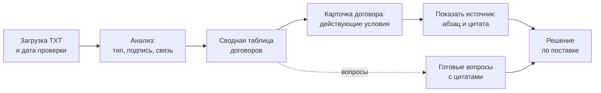
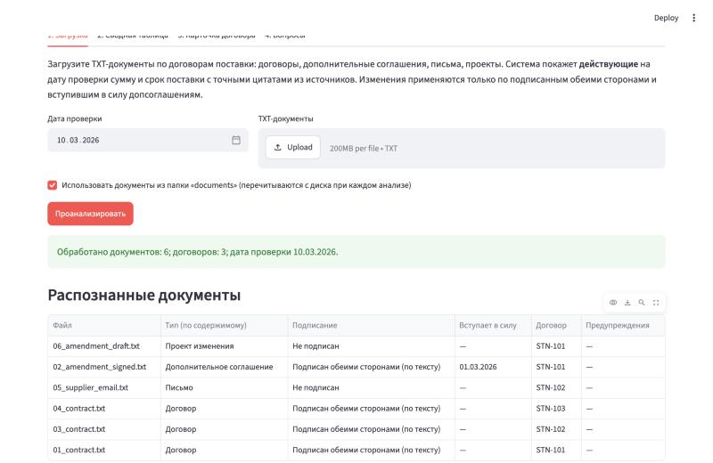
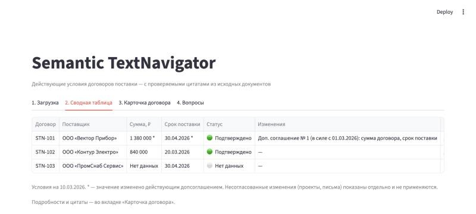
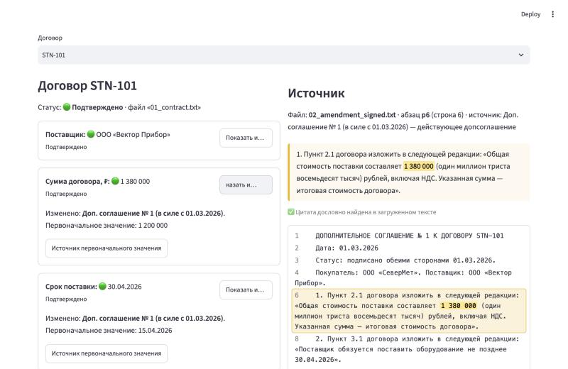
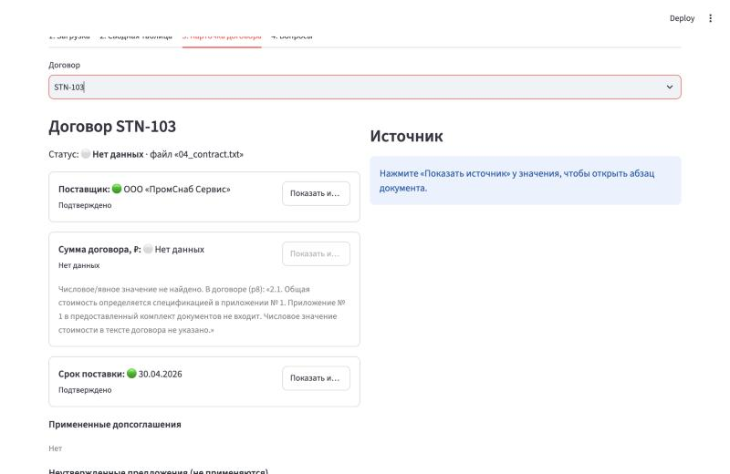
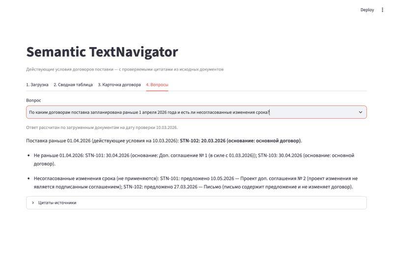
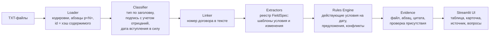

# Semantic TextNavigator — Product Case Study

**Действующие условия договоров поставки за минуту: каждое значение с дословной цитатой из источника**

| | |
|---|---|
| Роль | Product Owner / Product Lead: постановка задачи, бизнес-правила, критерии приемки, управление AI-разработкой, приемка и публикация |
| Разработка | Claude Code (AI-агент) по моей постановке; код, тесты и документация сгенерированы агентом и приняты мной по критериям приемки |
| Формат | MVP по тестовому заданию, 6 учебных документов |
| Стек | Python 3.13, Streamlit 1.66, pytest 8.4; без LLM и платных API |
| Статус | Работает локально и публично: [semantic-textnavigator.streamlit.app](https://semantic-textnavigator.streamlit.app) · код: [GitHub](https://github.com/manafkristina-max/semantic-textnavigator) |
| Качество | 34 автотеста, все проходят; сквозной сценарий проверен в браузере локально и в облаке |

---

## 01. Executive Summary

**Проблема.** Условия договора поставки разнесены по нескольким документам: договор, допсоглашения, письма поставщика, проекты изменений. Чтобы ответить на вопрос «какой срок действует сегодня», закупщик вручную выясняет, какой документ подписан, вступил ли он в силу и какие пункты меняет. Цена ошибки — претензия поставщику по неверной дате, оплата неверной суммы, решение на основании неподписанного проекта.

**Для кого.** Специалист по закупкам, который перед приемкой, оплатой или претензией проверяет действующие условия договора.

**Решение.** Пользователь загружает TXT-документы и выбирает дату проверки. Система сама определяет тип и статус каждого документа, связывает его с договором, применяет только подписанные обеими сторонами и вступившие в силу допсоглашения. На выходе — сводная таблица, карточка договора и ответы на типовые вопросы. **Каждое значение открывается до дословной цитаты и абзаца исходного файла.**

**Результат.** Работающее приложение с четырьмя экранами: загрузка, сводная таблица, карточка с навигатором источников, готовые вопросы. На учебном наборе все контрольные ответы верны, включая заложенные в документы ловушки: аванс вместо суммы, срок оплаты вместо срока поставки, бюджетный лимит вместо цены, неподписанный проект и письмо. Приложение опубликовано по публичной ссылке.

**Моя роль.** Я сформулировала продукт как набор проверяемых требований: бизнес-правила юридической интерпретации, модель данных, 14 обязательных тестовых сценариев, требования к цитатам, экраны и критерии готовности. Разработку выполнял Claude Code. Я принимала результат по этим критериям, запросила финальную приемку в браузере (в ней нашлись и были исправлены два дефекта интерфейса) и приняла решения о публикации.

---

## 02. Business Problem

### Как выглядит процесс сегодня

1. Закупщик получает пакет: договор, одно или несколько допсоглашений, письма поставщика, проекты изменений.
2. Чтобы узнать действующий срок или сумму, он открывает каждый документ и выясняет: подписан ли он, кем, с какой даты действует, какие пункты меняет.
3. Затем вручную сводит итог и, если спросят, ищет, откуда взята цифра.

### Боль пользователя и риск для бизнеса

| Боль пользователя | Бизнес-риск |
|---|---|
| Нужно сверять несколько документов и помнить, что чем изменено | Время специалиста уходит на рутинную сверку |
| Письмо поставщика «переносим срок» выглядит как изменение условий | Решение принимается по неподписанному предложению |
| Рядом с суммой договора стоят аванс, НДС, лимит бюджета | Оплата или претензия на неверную сумму |
| Рядом со сроком поставки стоят срок оплаты и дата приемки | Претензия по неверной дате, спор с поставщиком |
| Ответ коллеге «срок — 30.04» нечем подтвердить | Решение нельзя проверить и защитить |

**Формулировка проблемы.** Закупщику нужно быстро и без ошибок определить действующие условия договора на конкретную дату и уметь подтвердить каждое значение документом. Сейчас это ручная сверка, в которой легко применить неподписанное изменение или перепутать похожие цифры.

---

## 03. Product Discovery & Hypothesis

> **Важно.** Customer discovery с реальными закупщиками не проводился. Проект выполнен как тестовое задание. Описание пользователя, контекста и болей опирается на постановку задания и устройство учебных документов. Ниже это разделено явно.

### Jobs To Be Done

> **Когда** мне нужно принять решение по поставке (приемка, оплата, претензия), **я хочу** за минуту увидеть действующие сумму и срок с основанием, **чтобы** не применить по ошибке неподписанное изменение и иметь подтверждение для коллег.

| | |
|---|---|
| Основной пользователь | Специалист по закупкам |
| Задача | Определить действующие на дату условия договора: поставщик, сумма, срок поставки |
| Контекст | Пакет из 3–10 текстовых документов по нескольким договорам; проверка перед операционным решением |
| Ожидаемый результат | Значение + основание (договор или конкретное допсоглашение) + цитата + список того, что предложено, но не действует |

### Факты и гипотезы

| Подтверждено | Гипотеза, требует проверки |
|---|---|
| В учебных документах есть все типовые ловушки: аванс, лимит, срок оплаты, дата приемки, письмо, неподписанный проект | Закупщики тратят на такую сверку значимое время |
| Правило «условия меняет только подписанное и вступившее в силу допсоглашение» задано в документах (п. 5.1) и в постановке | Пользователь доверяет автоматическому ответу, только если видит цитату |
| На учебном наборе система дает верные ответы на все 4 контрольных вопроса (тесты + ручная проверка) | Правила, настроенные на учебные формулировки, переносятся на реальные договоры компании |

**Ключевая продуктовая гипотеза.** Если каждое значение сопровождать проверяемой цитатой, а неподтвержденные случаи честно помечать «Требуется проверка», закупщик будет использовать систему для операционных решений вместо ручной сверки, и доля ошибок применения неподписанных изменений снизится.

**Как проверить.** Пилот с 3–5 закупщиками на 50–100 реальных пакетах документов: сравнить время до ответа и число расхождений с ручной проверкой; провести интервью о доверии к ответу с цитатой и без нее.

---

## 04. Product Goals & Success Metrics

### Цели MVP

1. **Корректность:** на учебном наборе — 100% верных действующих значений и ни одного примененного неподписанного изменения.
2. **Проверяемость:** у каждого подтвержденного значения есть файл, абзац и дословная цитата, а присутствие цитаты в тексте проверяется программно.
3. **Честность:** при отсутствии значения — «Нет данных», при недостатке доказательств — «Требуется проверка», без догадок.
4. **Расширяемость:** новое поле (например, ставка неустойки) добавляется без переписывания приложения.

Цели 1–3 подтверждены автотестами и ручной проверкой на учебном наборе. Цель 4 подтверждена экспериментом: поле «неустойка» было подключено по инструкции `EXTENSION_GUIDE.md` в отдельном проверочном скрипте и извлекло ставки 0,1% и 0,05% с проверенными цитатами. В само приложение поле не добавлялось.

### Основные метрики (предлагаемые KPI — не измерялись)

| Метрика | Определение | Как измерять | Целевой ориентир |
|---|---|---|---|
| **Точность действующих условий** | Доля значений со статусом «Подтверждено», совпадающих с эталонной ручной разметкой | Размеченная выборка ≥ 100 договоров; автоматический прогон при каждом изменении правил | ≥ 99% |
| **Время до проверенного ответа** | Медианное время от загрузки пакета до фиксации ответа по договору | События в интерфейсе (загрузка → карточка → «Показать источник») против замера ручной сверки | Сокращение в 3+ раза относительно ручной сверки |

### Дополнительные метрики

| Метрика | Зачем |
|---|---|
| Доля значений с подтвержденной цитатой | Контроль принципа проверяемости; должна быть 100% среди «Подтверждено» |
| Доля «Требуется проверка» | Полнота автоматизации; рост — сигнал новых формулировок в документах |
| Число примененных неподписанных изменений | Критичный дефект; целевое значение — 0 |

---

## 05. MVP Scope & Prioritization

### Принципы приоритизации

| Критерий | Как повлиял на объем MVP |
|---|---|
| Пользовательская ценность | В MVP — три поля, которые нужны для решения по поставке: поставщик, сумма, срок |
| Риск ошибки | Правила подписи, даты вступления в силу и конфликтов реализованы полностью, даже ценой объема функций |
| Ограничение времени | Бюджет задания — 4 часа: только TXT, без БД, без авторизации |
| Техническая сложность | Детерминированные правила вместо LLM: предсказуемо, тестируемо, без внешних API |
| Критерии приемки | 14 обязательных тестовых сценариев задали границу «готово» |

### Must Have / Should Have / Later

| Must Have (сделано) | Should Have (частично или осознанно отложено) | Later (roadmap) |
|---|---|---|
| Загрузка нескольких TXT, UTF-8/BOM/Windows-1251 | Извлечение неустойки: путь проверен, в UI не добавлено | DOCX и PDF с текстовым слоем |
| Определение типа и подписи по содержимому | Сверка суммы прописью с цифрами | Ручное подтверждение и комментарий к «Требуется проверка» |
| Связь документов с договором по номеру в тексте | Экспорт таблицы в Excel | Косвенные изменения («увеличить на 10%»), относительные сроки |
| Действующие условия на дату проверки | | Хранилище, очередь, поиск по корпусу |
| Несогласованные предложения отдельно от действующих условий | | Ролевая модель доступа и аудит |
| Цитата + абзац + программная проверка цитаты | | Интеграции с СЭД, ERP, ЭДО |
| 4 готовых вопроса, ответы вычисляются из документов | | |
| Статусы «Подтверждено» / «Нет данных» / «Требуется проверка» | | |

---

## 06. Solution & User Journey

### Экран 1. Загрузка и распознавание документов

**Какую проблему решает:** прозрачность входа. Пользователь сразу видит, как система поняла каждый файл: тип по содержимому, статус подписи, дату вступления в силу, номер договора. Имя файла на это не влияет. Ошибку классификации видно до того, как она повлияет на ответ.

### Экран 2. Сводная таблица

**Какую проблему решает:** обзор портфеля за один взгляд. Звездочка показывает, что значение изменено действующим допсоглашением. Колонка «Изменения» называет основание. Справа есть колонка «Несогласованные изменения»; на этом снимке она не поместилась по ширине. STN-103 честно получает «Нет данных» вместо бюджетного лимита.

### Экран 3. Карточка договора и навигатор источников

**Какую проблему решает:** доверие и защита решения. Для суммы 1 380 000 ₽ видно, что она изменена допсоглашением № 1, первоначально была 1 200 000 ₽. Кнопка «Показать источник» открывает абзац p6 допсоглашения, подсвечивает число и подтверждает: «Цитата дословно найдена в загруженном тексте».

**Отсутствие данных — тоже ответ.** Для STN-103 система не подставляет число, а цитирует пункт 2.1: стоимость определяется приложением, которого нет в комплекте. Кнопка источника неактивна, потому что источника у значения нет.

### Экран 4. Готовые вопросы

**Какую проблему решает:** типовой вопрос руководителя без ручной сборки. Сравнение строгое («раньше 1 апреля» не включает 01.04). Несогласованные переносы срока перечислены отдельно и не влияют на ответ.

---

## 07. Product Logic & Business Rules

> **Every answer must be traceable to its source.**
> Значение без источника в этом продукте не считается значением.

### Правила определения действующих условий

| # | Правило | Как реализовано |
|---|---|---|
| 1 | Основной договор задает исходные условия | Поля извлекаются из договора по шаблонам с контекстом условия |
| 2 | Подписанное обеими сторонами и вступившее в силу допсоглашение может изменить условие | Требуются три признака: «подписано обеими сторонами» в тексте, явная дата вступления в силу, эта дата ≤ даты проверки |
| 3 | Допсоглашение меняет только явно указанные пункты | Из «Пункт 2.1 изложить в следующей редакции: «…»» извлекается новая редакция пункта и проверяется теми же правилами, что и договор |
| 4 | Письмо поставщика не меняет условия | Письмо всегда попадает в «Несогласованные предложения» |
| 5 | Неподписанный проект не меняет условия | Проект всегда попадает в «Несогласованные предложения» |
| 6 | Подписанное допсоглашение с датой вступления позже даты проверки не применяется | Показывается как «не вступило в силу», значение не меняется |
| 7 | Недостаточно доказательств — нужна ручная проверка | Неизвестный статус подписи, нет даты вступления в силу, противоречивые признаки → «Требуется проверка» |
| 8 | Нет значения — «Нет данных», без догадок | Аванс, НДС, лимит, срок оплаты не подходят под шаблоны условий |
| 9 | Конфликт действующих соглашений | Разные даты вступления в силу → применяется более позднее, с пометкой; одинаковые даты и разные значения → «Требуется проверка» |
| 10 | Имя файла и порядок загрузки не влияют на результат | Идентификатор документа — хэш содержимого; порядок обработки детерминирован; проверено тестами 9 и 13 |

### Пример на учебном наборе

| Договор | Исходно | Документы | Действует на 10.03.2026 |
|---|---|---|---|
| STN-101 | 1 200 000 ₽, до 15.04.2026 | ДС № 1 подписано, в силе с 01.03.2026; проект ДС № 2 не подписан | **1 380 000 ₽, до 30.04.2026** (ДС № 1). Проект: 1 450 000 ₽ / 10.05.2026 — не применяется |
| STN-102 | 840 000 ₽, до 20.03.2026 | Письмо: перенос на 27.03.2026, согласия нет | **840 000 ₽, до 20.03.2026**. Письмо — несогласованное предложение |
| STN-103 | Сумма в приложении, которого нет; лимит бюджета 600 000 ₽ | — | **Нет данных** / до 30.04.2026 |

### Почему проверяемость — ключевое требование, а не функция

1. **Доверие.** Закупщик несет ответственность за решение. Без цитаты ему придется перепроверять все вручную, и продукт не сэкономит время.
2. **Защита от галлюцинаций.** Значение, которое нельзя найти дословно в тексте, система не выдаст. Это требование встроено в модель данных (`Evidence`) и проверяется кодом (`verify_evidence`).
3. **Аудит.** Ответ «1 380 000 ₽, ДС № 1, абзац p6» можно переслать юристу или руководителю — он проверит за секунды.
4. **Управление качеством.** Каждая ошибка извлечения сразу видна по цитате, что упрощает разбор и улучшение правил.

---

## 08. Technology & AI-Assisted Development

### Фактический стек

| Слой | Технология | Почему |
|---|---|---|
| Язык | Python 3.13, стандартная библиотека (`re`, `dataclasses`, `enum`, `hashlib`) | Быстрая разработка, минимум зависимостей |
| Интерфейс | Streamlit 1.66 | Рабочий B2B-интерфейс за часы, без отдельного фронтенда; горячая перезагрузка для live coding |
| Тесты | pytest 8.4, `streamlit.testing.AppTest` | Бизнес-правила и UI-сценарий проверяются автоматически |
| Публикация | GitHub + Streamlit Community Cloud | Бесплатная публичная ссылка, автообновление после push |
| Объем | ≈ 1 580 строк Python, включая тесты | |

### Архитектура

| Компонент | Что делает |
|---|---|
| **Извлечение** | Каждое поле — запись `FieldSpec`: шаблоны формулировки условия («Общая стоимость … составляет N рублей»), шаблоны изменения («изменить … на …»), нормализация. Новое поле добавляется одной записью |
| **Связывание** | Номер договора ищется в тексте документа. Несколько разных номеров → «неоднозначная связь», документ не применяется |
| **Движок правил** | Для каждого договора: базовые значения → категоризация связанных документов (применено / не вступило в силу / предложение / статус не установлен) → итоговое значение и статус для каждого поля |
| **Доказательная база** | `Evidence` хранит файл, абзац, дословный текст абзаца и извлеченный фрагмент. `verify_evidence` проверяет, что цитата есть в исходном тексте, а фрагмент — в цитате |

### Почему без LLM внутри приложения

| Критерий | Правила (выбрано) | LLM |
|---|---|---|
| Воспроизводимость | Одинаковый вход → одинаковый ответ | Ответ может меняться |
| Галлюцинации | Невозможны по построению | Требуют отдельного контроля |
| Объяснимость | Каждое значение — совпадение шаблона в конкретном абзаце | Объяснение генерируется моделью |
| Стоимость и офлайн | Бесплатно, работает локально | Платный API или локальная модель |
| Гибкость к формулировкам | Низкая: новые обороты требуют шаблонов | Высокая |

**Решение:** для MVP с требованием «ноль выдуманных значений» правила надежнее. При переходе на реальные договоры с разнообразными формулировками LLM разумно использовать как генератор кандидатов, но итоговое значение по-прежнему должно пройти проверку дословной цитатой.

### Как использовался Claude Code

| Этап | Что делала я (Product Owner) | Что делал Claude Code |
|---|---|---|
| Постановка | Мастер-промпт: роли, бизнес-правила, модель данных, 14 тестовых сценариев, экраны, критерии готовности, бюджет времени | Прочитал документы, составил анализ рисков и архитектуру |
| Реализация | Запрет хардкода ответов и логики под конкретные договоры; требование цитат | Сгенерировал модули, интерфейс, тесты, README, DEMO, руководство по расширению |
| Тестирование | Требование не заявлять «тесты пройдены» без запуска | Запускал pytest; проверил, что тесты ловят ошибки: при отключенном правиле подписи упало 5 тестов |
| Приемка | Запрос финальной проверки: загрузка, таблица, вопросы, переходы к цитатам | Прошел сценарии в браузере, нашел и исправил 2 дефекта UI, добавил регрессионный тест |
| Live coding | Правила работы на интервью: цикл «запрос → код → тесты → запуск → проверка → отчет» | Зафиксировал правила в `CLAUDE.md`; настроил горячую перезагрузку |
| Публикация | Решения: публичный репозиторий, Streamlit Cloud | Создал репозиторий, загрузил код, диагностировал проблему входа, заполнил форму публикации, проверил облачную версию |

**AI не был безошибочным.** Агент сам допускал недочеты: слабый тест, проходивший всегда; хранение объектов в сессии, которое ломалось бы при горячей перезагрузке; дефекты интерфейса, найденные только на браузерной приемке (см. раздел 09). Критерии приемки и требование проверять каждый шаг сделали эти ошибки видимыми.

---

## 09. Validation & Quality Assurance

### Фактические результаты

**34 автотеста, 34 passed** (`./run.sh test`, Python 3.13, pytest 8.4.2).

| Группа | Тестов | Что проверяет |
|---|---|---|
| Обязательные сценарии 1–14 и их варианты | 19 | Извлечение, изменение суммы в исходнике, подписанное ДС, неподписанный проект, письмо, отсутствующая сумма и срок, цитаты, переименование файлов, дата проверки, новый договор, конфликт, порядок загрузки, граничная дата 31.03 / 01.04 |
| Компоненты | 10 | Кодировки UTF-8 BOM и Windows-1251, пустые и нечитаемые файлы, тип по содержимому, «не подписано», подпись одной стороной, противоречивые признаки, неоднозначная связь, нормализация сумм и дат |
| Вопросы и интерфейс | 5 | Ответы на 4 вопроса на учебном наборе; сквозной UI-сценарий через `AppTest` |

| Что проверено | Как | Результат |
|---|---|---|
| Корректность извлечения | Тест 1, вопросы 1–3 | STN-101: 1 200 000 ₽ / 15.04.2026 из договора; 840 000 ₽ у STN-102, аванс не взят |
| Действие подписанных соглашений | Тесты 3, 10, 10b | ДС меняет только указанный пункт; не действует до даты вступления в силу |
| Игнорирование проектов и писем | Тесты 4, 4b, 5 | Значения не меняются, предложения показаны отдельно |
| Отсутствующие значения | Тесты 6, 6b, 7 | «Нет данных»; лимит 600 000 ₽ и аванс не подставлены |
| Достоверность цитат | Тест 8 | Каждая цитата есть в исходном тексте; проверено ≥ 12 цитат |
| Изменение исходного текста | Тест 2 + проверочный скрипт на учебном наборе | Правка 840 000 → 900 000 в тексте STN-102 меняет ответ на вопрос 2 |
| Новый договор | Тест 11 + `demo/STN-104_new_contract.txt` | Договор появляется в таблице и в вопросе 4 без изменения кода |
| Тесты действительно ловят ошибки | Мутационная проверка | Правило «неподписанные не применяются» отключено → 5 тестов упали |
| Публичная версия | Ручная проверка в браузере | Таблица, переход к цитате и вопрос 1 совпадают с локальной версией; ссылка открывается без входа (HTTP 200) |

### Найденные и исправленные дефекты

**Дефект 1. Цитата чужого договора на экране**
- **Проблема:** в карточке STN-101 открыть источник, затем выбрать STN-103 — панель продолжала показывать цитату из документа STN-101.
- **Причина:** выбранный источник хранился в сессии без привязки к договору.
- **Исправление:** при смене договора панель источника сбрасывается.
- **Повторная проверка:** добавлен шаг в сквозной UI-тест. Без исправления тест падал, с исправлением — проходит. Повторно проверено в браузере.

**Дефект 2. Источник открывался за пределами экрана**
- **Проблема:** при нажатии «Показать источник» внизу карточки абзац появлялся вверху страницы, и пользователю приходилось листать вверх.
- **Причина:** панель источника была обычным блоком в правой колонке.
- **Исправление:** панель закреплена при прокрутке.
- **Повторная проверка:** визуально в браузере; заодно подтверждено, что после горячей перезагрузки кода загруженные документы и открытый источник сохраняются.

Оба дефекта найдены на финальной приемке в браузере, а не автотестами. Это аргумент в пользу обязательной ручной приемки пользовательских сценариев.

---

## 10. Results & Business Value

### Подтвержденные результаты MVP

- Работающее приложение: локально (`./run.sh`) и публично — [semantic-textnavigator.streamlit.app](https://semantic-textnavigator.streamlit.app).
- Верные действующие условия по трем учебным договорам, включая все заложенные ловушки.
- Каждое подтвержденное значение открывается до абзаца исходного файла с программной проверкой цитаты.
- 34 автотеста проходят; тесты чувствительны к нарушению ключевого правила.
- Новый договор аналогичного формата обрабатывается без изменения кода.
- Подготовлены README, сценарий демонстрации, руководство по расширению и правила live coding.

### Потенциальный бизнес-эффект (не измерялся)

| Эффект | Механизм | Как подтвердить |
|---|---|---|
| Сокращение ручного анализа | Сводная таблица и готовые ответы вместо сверки документов | Замер времени до ответа на пилоте |
| Снижение риска неверной интерпретации | Неподписанные документы технически не могут изменить условия | Подсчет таких ошибок до и после внедрения |
| Прозрачность решений | Ответ с цитатой и абзацем можно переслать и проверить | Опрос пользователей и юристов |
| Ускорение работы закупщиков | Меньше переключений между документами | Событийная аналитика в интерфейсе |

Процентов экономии времени или денег здесь нет сознательно: измерений на реальных пользователях не проводилось.

---

## 11. Key Product Decisions & Trade-offs

### Решение 1. Детерминированные правила вместо LLM

| | |
|---|---|
| Проблема | Нужен ответ без выдуманных значений, воспроизводимый и объяснимый |
| Альтернативы | LLM-извлечение; гибрид «LLM предлагает — правила проверяют» |
| Почему выбрано | Требование «ноль галлюцинаций» и бюджет 4 часа; работа офлайн без платных API; простое тестирование |
| Чем пожертвовали | Гибкостью к новым формулировкам |
| Оставшийся риск | На реальных договорах доля «Нет данных» может быть высокой. Митигация: метрика доли ручной проверки и гибридная архитектура на следующем этапе |

### Решение 2. Консервативные статусы вместо «лучшей догадки»

| | |
|---|---|
| Проблема | Что показывать, если доказательств недостаточно |
| Альтернативы | Показать наиболее вероятное значение; показать значение из договора с предупреждением |
| Почему выбрано | Ошибка «показали неверный срок» дороже, чем «попросили проверить» |
| Чем пожертвовали | Полнотой автоматизации на «грязных» документах |
| Оставшийся риск | Пользователя может раздражать частая «Требуется проверка». Митигация: ручное подтверждение с комментарием (roadmap) |

### Решение 3. Допсоглашение меняет только явно изложенные пункты

| | |
|---|---|
| Проблема | Как понять, что именно меняет соглашение |
| Альтернативы | Искать любые суммы и даты в тексте соглашения; поддержать произвольные формулировки |
| Почему выбрано | Так устроено право: «Пункт 2.1 изложить в следующей редакции». К новой редакции применяются те же правила, что к договору, без дублирования логики |
| Чем пожертвовали | Косвенные изменения («цена увеличивается на 15%») не поддерживаются |
| Оставшийся риск | Такие формулировки дадут «Нет изменений» вместо пересчета. Митигация: отдельный тип изменения с обязательной ручной проверкой |

### Решение 4. Конфликт соглашений: более позднее побеждает, равные даты — на проверку

| | |
|---|---|
| Проблема | Два действующих соглашения меняют одно условие |
| Альтернативы | Всегда «Требуется проверка»; брать последнее по порядку загрузки |
| Почему выбрано | Новая редакция пункта юридически заменяет предыдущую. Порядок загрузки — случайный признак, его использовать нельзя |
| Чем пожертвовали | Простотой: правило требует пояснения пользователю (в интерфейсе выводится пометка) |
| Оставшийся риск | Нестандартные конструкции («отменить ДС № 1») не распознаются |

### Решение 5. Streamlit вместо отдельного фронтенда

| | |
|---|---|
| Проблема | Нужен рабочий интерфейс за часы и возможность правок вживую на интервью |
| Альтернативы | React + API; CLI |
| Почему выбрано | Один язык, горячая перезагрузка, бесплатная публикация |
| Чем пожертвовали | Гибкостью верстки: в узком окне обрезаются подписи кнопок, широкие таблицы прокручиваются |
| Оставшийся риск | Для продакшена с ролями и большой нагрузкой интерфейс придется переписать |

**Баланс.** Во всех решениях точность и объяснимость поставлены выше гибкости и визуальной сложности: для юридически значимых условий это правильный порядок для MVP.

---

## 12. Roadmap & Scaling

> Ниже — планы. Ни одна из этих возможностей не реализована.

| Этап | Что | Ценность для пользователя |
|---|---|---|
| 1 | Ручное подтверждение и комментарий к «Требуется проверка» | Закрывает рабочий цикл закупщика; дает разметку для метрики точности |
| 2 | DOCX и PDF с текстовым слоем | Снимает главный барьер реального использования |
| 3 | Новые поля: неустойка, условия оплаты, график партий | Ответ на вопрос «что будет при просрочке» |
| 4 | Гибридное извлечение: LLM предлагает кандидата, правила и проверка цитаты валидируют | Выше полнота при сохранении проверяемости |
| 5 | Интеграции: СЭД, ERP/1С, ЭДО | Документы попадают в систему без ручной загрузки, статус подписи — из ЭДО |
| 6 | Ролевая модель и аудит | Безопасная работа команды и юристов |

### Сценарий 100 000 документов

| Сейчас (MVP) | При 100 000 документов |
|---|---|
| Синхронный анализ в сессии браузера | Асинхронная обработка: загрузка возвращает id задачи, воркеры обрабатывают документы |
| Файлы в памяти сессии | Объектное хранилище для оригиналов (неизменяемые версии), PostgreSQL для метаданных, абзацев, условий, цитат |
| Поиск отсутствует | Поисковый индекс (например, OpenSearch) по абзацам с фильтрами по договору, типу, статусу |
| Пересчет всего пакета | Инкрементальный пересчет только связанного договора; переобработка корпуса при новой версии правил |
| Нет очереди | Очередь задач с идемпотентностью по хэшу содержимого (он уже сейчас служит id документа) |
| Нет доступа | Права на уровне документа; ответы и цитаты фильтруются по правам пользователя |
| Нет аудита | Журнал: кто загрузил, какая версия правил дала значение, кто подтвердил вручную |
| Качество проверяется тестами | Мониторинг доли «Требуется проверка», расхождений с ручными правками, выборочная разметка |

---

## 13. Lessons Learned

1. **AI ускоряет реализацию, но не заменяет приемку.** Оба дефекта интерфейса прошли автотесты и нашлись только при проходе сценариев в браузере. Поэтому финальную приемку по списку пользовательских сценариев я сделала обязательным шагом, а ее результат — основанием для решения «готово».
2. **Четкие критерии приемки — главный инструмент управления AI-разработкой.** 14 тестовых сценариев и запрет хардкода превратили размытую задачу в проверяемую. Требование «не утверждай, что тесты пройдены, если не запускал» заставило агента показывать фактические результаты.
3. **Качество бизнес-правил важнее визуальной сложности.** Ценность продукта — в правиле «условия меняет только подписанное и вступившее в силу соглашение», а не в интерфейсе. Правила сформулированы до первой строки кода.
4. **Проверяемость ответа — условие доверия.** Если значение нельзя подтвердить цитатой, закупщик все равно пойдет перепроверять вручную, и продукт теряет смысл. Поэтому цитата стала частью модели данных, а не надстройкой в интерфейсе.
5. **Честное «не знаю» — продуктовая функция.** «Нет данных» для STN-103 вместо бюджетного лимита — пример того, как отказ от догадки защищает пользователя от ошибки.

---

## Что требует дополнительной проверки

| Утверждение | Статус | Как подтвердить |
|---|---|---|
| Ценность для реальных закупщиков | Гипотеза | Пилот с 3–5 пользователями, интервью |
| Время на сверку и эффект от продукта | Не измерялось | Замер «до/после» на одном наборе пакетов |
| Работа на реальных договорах компании | Не проверялась | Прогон на обезличенной выборке, подсчет доли «Нет данных» |
| Загрузка файлов через кнопку Upload в браузере | Агент не мог выполнить сам; обработка после загрузки та же, что у проверенной загрузки из папки | Перетащить 6 TXT вручную перед демонстрацией |
| Время разработки | Первая версия с тестами и документацией — около 11 минут работы агента по системным часам (18:16–18:27, 02.11.2026). Финальная приемка, исправления и публикация — в тот же вечер; коммиты в 22:49 и 23:00 | Время человека на постановку и приемку не измерялось |
